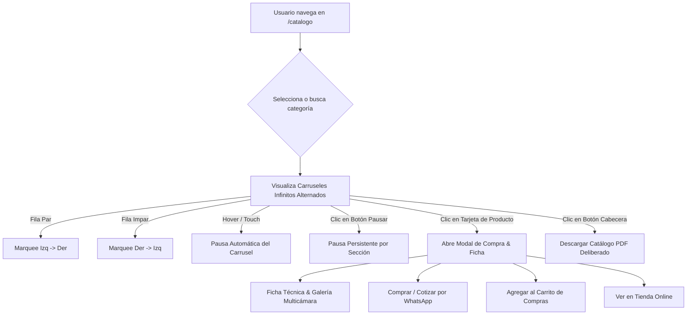

# 🏛️ Rediseño de Catálogo: Carruseles Infinitos Alternados & Modal de Compra Inmediata

## 📌 Contexto y Diagnóstico
En la versión previa de `/catalogo`, cada categoría mostraba 4 imágenes estáticas. Al hacer clic en cualquiera de ellas, se disparaba automáticamente la descarga de un archivo PDF (`handleDownloadPdf`), lo cual generaba una fricción severa de UX: el usuario esperaba ver información detallada del producto para cotizar o comprar, y en su lugar se iniciaba una descarga pesada e imprevista.

Asimismo, la sección lucía estática y poco atractiva frente al catálogo real de más de 140 modelos con tableros Pelikano RH 18mm, herrajes Blum y mesones de cuarzo.

---

## ⚡ Solución Arquitectónica Implementada

### 1. Eliminación de Descarga Involuntaria
- Se eliminó el disparador de PDF al hacer clic sobre fotos o tarjetas de productos.
- La descarga de catálogo PDF se mantiene como una opción explícita y deliberada mediante un botón dedicado en la cabecera de la sección ("Descargar PDF") y un enlace secundario dentro de la ficha técnica.

### 2. Modal de Compra y Ficha Técnica de Autor (`Dialog`)
Al hacer clic sobre cualquier producto, se despliega un diálogo accesible con estética luxury:
- **Galería Fotorrealista**: Imagen en alta resolución con selector de ángulos secundarios.
- **Transparencia Comercial**: Precio unitario (por metro lineal o unidad), facilidades de pago (tarjeta de crédito hasta 12 meses, transferencia, anticipo del 50%).
- **Especificaciones Técnicas**: Melamina Pelikano RH 18mm hidrófuga, herrajes Blum con cierre suave, tiempos de fabricación y cobertura nacional.
- **Conversión Directa**:
  - Botón WhatsApp prellenado con el modelo exacto y solicitud de asesoría técnica.
  - Botón de agregado directo al carrito (`useCart`).
  - Acceso directo a la tienda en línea.

### 3. Carruseles Infinitos Alternados (Marquee Bidireccional)
- Cada categoría renderiza todos sus productos reales (entre 11 y 34 por categoría) duplicados en un track continuo para lograr un bucle infinito matemáticamente continuo sin saltos visuales.
- **Alternancia de Dirección**:
  - Filas pares (Cocinas, Baños, Oficina, Gamer): Desplazamiento de Izquierda a Derecha (`animate-marquee-ltr`).
  - Filas impares (Clósets, Escritorios, Puertas, Estimulación): Desplazamiento de Derecha a Izquierda (`animate-marquee-rtl`).
- **Micro-interacciones y Control Táctil**:
  - Pausa automática al pasar el cursor o presionar (`hover` y `active`).
  - Botón individual en cada cabecera para "Pausar / Reanudar" el carrusel a voluntad.
  - Acabado cinematográfico con máscara de degradado en los extremos (`marquee-mask`).

---

## 🔄 Diagrama de Flujo de Interacción

---

## 🔗 Enlaces Relacionados (Obsidian Vault)
- [[08_Catalog_Curation_and_Store_Sync]]
- [[12_Mobile_UX_and_Desktop_Catalog_Filter]]
- [[15_Image_404_Fix_Infinite_Carousels_and_Affiliates_CTA]]
- [[16_Store_Category_Filter_Fix_and_MultiPage_PDF_Engine]]
