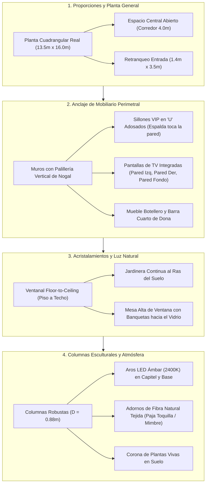

# 🏛️ Lecciones de Arquitectura 3D y Reconstrucción Espacial desde Conceptos 2D

Este documento compila las lecciones maestras aprendidas durante la reconstrucción hiperrealista del **Lounge & Bar 3D** en Blender 5.2 para [[docs/agent-handoff|Modulares GM]], sincronizado con la bóveda de Obsidian y el cerebro compartido de coordinación.

---

## 🧠 Diagrama de Arquitectura de Espacio Abierto (Open Lounge)

---

## 🎯 1. La Trampa de la Proporción: Túnel vs. Espacio Abierto
* **Error inicial:** Asumir una proporción estrecha ($9.0\text{ m} \times 16.0\text{ m}$), convirtiendo el salón en un tubo o vagón largo donde todo el mobiliario se apelotona en el eje central.
* **Principio arquitectónico:** Un *Lounge VIP de Hospitalidad* contemporáneo es un espacio ancho y proporcionado (relación $W:L$ cercana a $4:5$, ej. $13.5\text{ m} \times 16.0\text{ m}$). 
* **Efecto directo:**
  - El pasillo central entre columnas y sofás pasa de ser un desfiladero a una avenida amplia de circulación fluida.
  - La tarima de acceso, la mesa alta frontal y el escenario acústico se distribuyen sin colisionar con las cristaleras.

---

## 🛋️ 2. Regla de Oro del Mobiliario Perimetral: Adosamiento Estricto
* **Error:** Colocar sofás tipo *booth* flotando en el interior, dejando un pasillo ciego de $1.8\text{ m}$ detrás del respaldo.
* **Principio:** Los *booths* en hostelería de lujo son **mobiliario de obra o carpintería fija adosada**.
* **Regla matemática:**
  $$\text{PosiciónX}_{\text{Sofá}} = \text{MuroX} \mp \frac{\text{ProfundidadBooth}}{2}$$
  El respaldo toca el revestimiento de palillería. La pantalla de TV queda alineada al centro del área de estar y las lamas de madera actúan como cabecero acústico.

---

## 🚪 3. El Retranqueo de Entrada y Zonas de Transición
* **Error:** Hacer un quiebre tímido de $30\text{ cm}$ en la pared exterior.
* **Principio:** Los accesos desde el exterior requieren un nicho generoso (mínimo $1.2\text{ m}$ a $1.5\text{ m}$ de saliente) que cree un vestíbulo o *foyer*.
* **Composición:**
  - Plataforma elevada de madera noble con escalones iluminados.
  - Banco corrido para descalzarse o esperar con iluminación rasante inferior (*toe-kick*).
  - Puerta batiente de acceso ubicada en el muro perpendicular.

---

## 📺 4. No Mutilar Muros Perimetrales: Las Tres Pantallas
* **Error:** Cortar muros perimetrales en 3D para "ver adentro" en isometría.
* **Lección:** Al cortar el muro derecho como un murete bajo blanco, se borró la pared real de palillería y la **tercera pantalla de TV** que da servicio a los 3 grupos de sofás de la derecha.
* **Estándar:** Toda pared que contenga equipamiento (TVs, apliques, botelleros) debe existir en su altura completa ($3.6\text{ m}$). Para renders axonométricos se recurre a la transparencia o ajuste de corte de cámara, no a la amputación geométrica del proyecto.

---

## 🪟 5. Ventanales Panorámicos Piso a Techo (*Floor-to-Ceiling*)
* **Error:** Colocar antepechos opacos altos o zócalos negros que convierten el vidrio en una ventana convencional.
* **Principio:** Las fachadas de terraza en locales VIP son muros cortina de cristal continuo que nacen a nivel del piso terminado ($Z = 0.00\text{ m}$) hasta la viga de cubierta, con montantes esbeltos de aluminio negro.
* **Mesa de Ventana:** Se ubica una mesa alta alargada ($3.4\text{ m} \times 0.85\text{ m}$) con taburetes situados entre la mesa y el ventanal, permitiendo a los clientes mirar hacia el interior o hacia la vista exterior.

---

## 🌾 6. Columnas de Identidad Boho-Luxury
* **Elementos indispensables:**
  1. Fuste cilíndrico robusto ($R = 0.44\text{ m}$, diámetro $0.88\text{ m}$) con palillería vertical densa.
  2. Doble anillo de iluminación LED dorada ($2400\text{K}$ - $2700\text{K}$) en capitel y zócalo.
  3. Corona botánica perimetral en la base.
  4. **Platos decorativos de fibra natural/mimbre (estilo paja toquilla)** dispuestos verticalmente en las caras de la columna, aportando relieve, artesanía y calidez textil.

---

## 💡 7. Iluminación Multi-punto de Hospitalidad (*Pools of Light*) y Espacio de Circulación
* **Error:** Confiar en una iluminación cenital o ambiental plana ("luz de oficina") que homogeniza el suelo y mata el contraste dramático de un lounge.
* **Principio de Hospitalidad:**
  - El ambiente nocturno se construye a través de **charcos de luz cálidos discretos (2700K)** proyectados en el piso.
  - Cada zona (pasillos laterales, avenida central, frente a la barra, faldón de columnas, mesa frontal y escenario) cuenta con su propio foco puntual descendente con desvanecimiento suave (*shadow soft size* 0.85m).
  - Esto produce el efecto visual característico donde el suelo refleja islas doradas de calidez y sombras sutiles que guían la mirada.
* **Circulación Holgada en Columnas:**
  - En un espacio ensanchado a $13.5\text{ m}$, las columnas centrales no asfixian el paso. Quedan más de **$4.0\text{ m}$ de circulación diáfana** tanto por el pasillo izquierdo como por el derecho, permitiendo al cliente y al personal transitar sin rozar mesas ni respaldos.

---

## 🔗 Enlaces Relacionados en la Bóveda
- [[docs/agent-handoff|Bitácora de Traspaso de Agentes]]
- [[docs/01_Arquitectura_General|Arquitectura General del Sistema]]
- [[docs/03_Diseno_Luxury_UI|Directrices de Diseño de Lujo y Materiales]]
